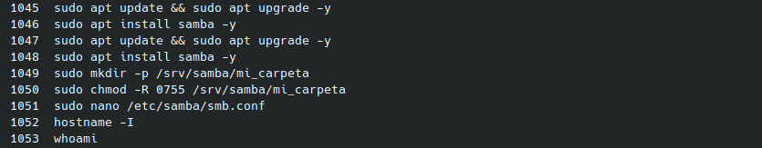
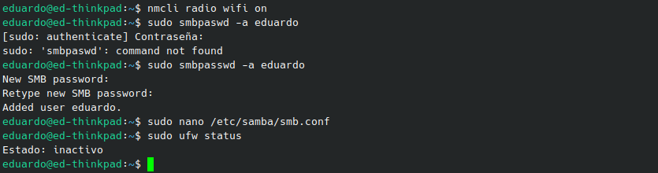

# Compartir archivos de Ubuntu a Windows con Samba

Práctica de Sistemas Operativos del Instituto Tecnológico de Mazatlán (Ingeniería en Sistemas Computacionales, 5° semestre).
Profesor: Miguel Ángel Barrón Hernández. Alumno: José Eduardo Pompa Rubio.

## Descripción

En esta práctica mi computadora con Ubuntu funcionó como servidor Samba y compartió una carpeta con un equipo con Windows de la misma red local. Del lado de Ubuntu se instala Samba, se crea la carpeta, se declara el recurso en `smb.conf` y se registra mi usuario en Samba. Del lado de Windows se entra a la carpeta por la IP del servidor desde el Explorador de archivos.

## Objetivos

- Instalar y configurar Samba en Ubuntu para compartir una carpeta con Windows.
- Entender para qué sirven los parámetros del recurso (`path`, `valid users`, `read only`, `create mask`, `directory mask`).
- Crear el usuario de Samba y revisar que el firewall no bloquee la conexión.
- Acceder desde Windows al recurso compartido usando la IP del servidor.

## Material utilizado

- Ubuntu (Kubuntu) como servidor, con terminal y permisos de `sudo`
- Paquetes `samba` y `smbclient`
- Editor `nano`
- Equipo con Windows en la misma red local
- IP del servidor Ubuntu: 192.168.20.217

## Estructura del repositorio

```
.
├── Codigo/
│   ├── configurar_samba_windows.sh
│   └── verificar_samba.sh
├── Terminal/
│   ├── comandos.md
│   └── capturas/
├── Reporte/
│   └── Informe_Samba_Windows.pdf
└── README.md
```

## Informe

El análisis del comportamiento del sistema y la justificación teórica están en [Reporte/Informe_Samba_Windows.pdf](Reporte/Informe_Samba_Windows.pdf).

## Comandos

Todos los comandos, tanto de Ubuntu como de Windows, están en orden y listos para copiar en [Terminal/comandos.md](Terminal/comandos.md).

## Scripts

| Script | Qué hace |
|---|---|
| [configurar_samba_windows.sh](Codigo/configurar_samba_windows.sh) | Instala Samba, crea la carpeta en `/srv/samba`, agrega el recurso a `smb.conf`, valida con `testparm`, registra al usuario, reinicia `smbd`, revisa el firewall y muestra la ruta que se escribe en Windows. |
| [verificar_samba.sh](Codigo/verificar_samba.sh) | Muestra usuario e IP, estado de `smbd`, validación de `smb.conf`, puertos 139 y 445, estado del firewall y, si se le pasa una IP, hace ping al equipo Windows. |

## Explicación de comandos

| Comando | Para qué sirve |
|---|---|
| `sudo apt update && sudo apt upgrade -y` | Actualiza la lista de paquetes y los programas instalados. |
| `sudo apt install samba -y` | Instala Samba, que permite compartir archivos con Windows. |
| `sudo mkdir -p /srv/samba/mi_carpeta` | Crea la carpeta que se va a compartir. `-p` crea también las carpetas intermedias. |
| `sudo chmod -R 0755 /srv/samba/mi_carpeta` | Pone los permisos: el dueño lee, escribe y entra; los demás solo leen y entran. |
| `sudo nano /etc/samba/smb.conf` | Abre la configuración de Samba para agregar el recurso. |
| `hostname -I` | Muestra la IP del servidor, que es la que se escribe en Windows. |
| `whoami` | Muestra el usuario con el que se está trabajando. |
| `sudo smbpasswd -a eduardo` | Da de alta al usuario en la base de contraseñas de Samba, que es distinta a la de Ubuntu. |
| `sudo ufw status` | Revisa si el firewall está activo y podría bloquear la conexión. |
| `sudo systemctl restart smbd` | Reinicia el servicio para que lea la configuración nueva. |
| `sudo testparm` | Revisa que `smb.conf` no tenga errores. |

Parámetros del bloque `[mi_carpeta]`:

| Parámetro | Significado |
|---|---|
| `path` | Carpeta del servidor que se comparte. |
| `browsable = yes` | El recurso aparece al explorar el servidor. |
| `read only = no` | Se puede leer y escribir. |
| `valid users` | Solo ese usuario puede entrar. |
| `create mask = 0664` | Permisos de los archivos nuevos (`rw-rw-r--`). |
| `directory mask = 0775` | Permisos de las carpetas nuevas (`rwxrwxr-x`). |

## Evidencias

**1. Instalación de Samba y creación de la carpeta en Ubuntu**



**2. Usuario de Samba y estado del firewall**



## Video

Demostración en vivo, con el acceso desde Windows: https://youtu.be/4Adap_lD9G0

## Conclusiones y resultados

- Samba permite que Windows vea una carpeta de Ubuntu como si fuera un recurso de red más, porque ambos usan el protocolo SMB.
- Samba tiene su propia contraseña por usuario. `smbpasswd -a` confirmó el alta con el mensaje "Added user eduardo".
- Una letra mal escrita en un comando (`smbpaswd`) produce `command not found`; al corregirlo el comando funcionó.
- El firewall `ufw` estaba inactivo, por lo que no bloqueaba los puertos de Samba. Si estuviera activo habría que usar `sudo ufw allow samba`.
- Cada cambio en `smb.conf` necesita reiniciar `smbd` para aplicarse.
- Windows necesita la IP del servidor, el nombre del recurso y el usuario con su contraseña SMB.
